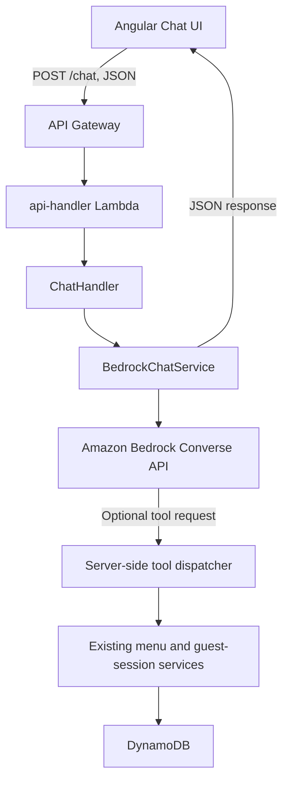

# AI Chat Architecture for Restaurant Booking Platform

## Goal

Build a Bedrock-powered restaurant assistant as a proof of concept (POC) in the existing Angular + .NET 10 Lambda + DynamoDB application.

The POC uses **one non-streaming `POST /chat` endpoint** and a regular JSON request/response. Streaming is explicitly out of scope; see [AI_CHAT_STREAMING.md](./AI_CHAT_STREAMING.md) for a separate follow-up stage.

## Current state

### Frontend

- The chat UI is in `frontend/restaurant-frontend-app/src/app/components/chat/`.
- `ChatService` is in `frontend/restaurant-frontend-app/src/app/services/chat/chat.service.ts`.
- The current service calls a hard-coded `/chat` URL. The backend has no chat route yet.
- The frontend service does not currently implement a JSON chat contract or handle HTTP errors.

### Backend

- The .NET 10 `api-handler` Lambda registers routes in `backend/restaurant-backend-app/dnapp/lambdas/api-handler/Routing/RouteRegistry.cs`.
- The backend already has guest-session, menu, cart, reservation, and order services. Existing routes and payloads are documented in `backend/restaurant-backend-app/docs/ApiRoutes.md`.
- Guest-session routes use a guest-session token for authorization. Do not treat IDs supplied by the model or request body as proof of access.
- The Lambda role is managed by Syndicate. Add Bedrock permissions through the role's existing management path, not by attaching a Terraform policy to a role Terraform does not manage.

## POC architecture



### POC scope

- Use Amazon Bedrock Converse API; do not build an Ollama alternative for this POC.
- Implement a single `POST /chat` request/response endpoint. Do not add `/chat/stream`, SSE, or Lambda response streaming.
- Start with a read-only `GetMenu` tool. If the demo must include adding a dish, add `AddDish` as a separately gated POC extension: require an explicit user confirmation and validate guest-session access on the backend before changing the cart.
- Do not expose `CreateOrder` or `SubmitCart` to the model in the POC. Keep consequential order submission in the existing explicit user flow.
- Do not persist chat history in DynamoDB for the POC. Send only a bounded recent history with each request; do not rely on Lambda memory for conversation state.
- Keep tool execution and authorization in the backend. The model may request an allowed tool, but it cannot authorize itself or supply trusted identity.

### Request and response contract

Use a small JSON contract. Final field names must be aligned with the frontend and backend DTO conventions when implementation starts.

Example request:

```json
{
  "message": "Show the menu",
  "history": [
    { "role": "user", "content": "Hello" },
    { "role": "assistant", "content": "Hello,World! My name is Valera, and I will take care of your table." }
  ],
  "context": {
    "guestSessionId": "guest-session-id"
  }
}
```

Example response:

```json
{
  "message": "Here is the menu for your session: ...",
  "toolCalls": [
    { "name": "GetMenu", "status": "succeeded" }
  ]
}
```

The backend must validate message length, history size, allowed roles, and context. Resolve identity from the established authorization mechanism and validate access to any guest session before invoking session-scoped operations. Never accept a bearer token in the chat message, history, or model context.

## Implementation stages

### Stage 1 — Bedrock and POC prerequisites

- Confirm Bedrock model availability, access, quotas, and pricing in the deployed `us-west-2` environment before selecting a model ID.
- Confirm the `api-handler-role` can invoke the selected model. Grant only the required Bedrock action and model resource through the Syndicate-managed role configuration.
- Keep model ID and other deploy-time settings configurable rather than embedding account-specific values in code.

### Stage 2 — Backend JSON chat

- Add minimal chat request/response DTOs and an `IChatService`.
- Implement `BedrockChatService` using the Converse API, including bounded conversation history and the `GetMenu` tool flow.
- Reuse existing menu/session services; do not make handlers call DynamoDB directly.
- Add `ChatHandler` and register only `POST /chat` in `RouteRegistry.cs`.
- Validate input and map invalid requests, authorization failures, and Bedrock errors to explicit HTTP responses with structured logging.
- Do not add streaming interfaces, chunk DTOs, an SSE handler, or a second `/chat` route in this stage.

### Stage 3 — Frontend JSON integration

- Update `ChatService` to call `${environment.apiUrl}/chat`; do not hard-code an API Gateway URL.
- Use the app's established authorization mechanism and provide only the context needed by the selected POC tool.
- Parse the JSON response, check `response.ok`, and show a useful error state when the request fails.
- Keep the chat's loading state until the complete response is received.

### Stage 4 — Verification and demo deployment

- Add backend unit tests for input validation, successful tool execution, rejected/unknown tool calls, authorization failures, and Bedrock failures.
- Add or update focused frontend tests for request payloads, successful responses, loading state, and HTTP errors.
- Run backend tests with `dotnet test Tests/APIHandler.Tests.csproj` from `backend/restaurant-backend-app`.
- Build/test the frontend using the scripts in `frontend/restaurant-frontend-app/package.json`.
- Deploy through the existing Syndicate workflow and verify the endpoint against the deployed API. There is no local backend HTTP host in this repository.

## POC acceptance criteria

- The frontend sends one JSON `POST /chat` request and renders one JSON response.
- The backend route is registered and uses Bedrock Converse in the configured region.
- The assistant can answer using the read-only menu tool, and the backend—not the model—executes and authorizes tool calls.
- Invalid input, authorization failures, and upstream Bedrock errors are visible as failures rather than success-shaped chat messages.
- No SSE, streaming response, chat-history persistence, or order submission behavior is included.

## Deferred work

Streaming is a separate follow-up, not a variation of the POC endpoint. Before implementing it, verify that the deployed API Gateway/Lambda integration supports the required response-streaming behavior. See [AI_CHAT_STREAMING.md](./AI_CHAT_STREAMING.md).
