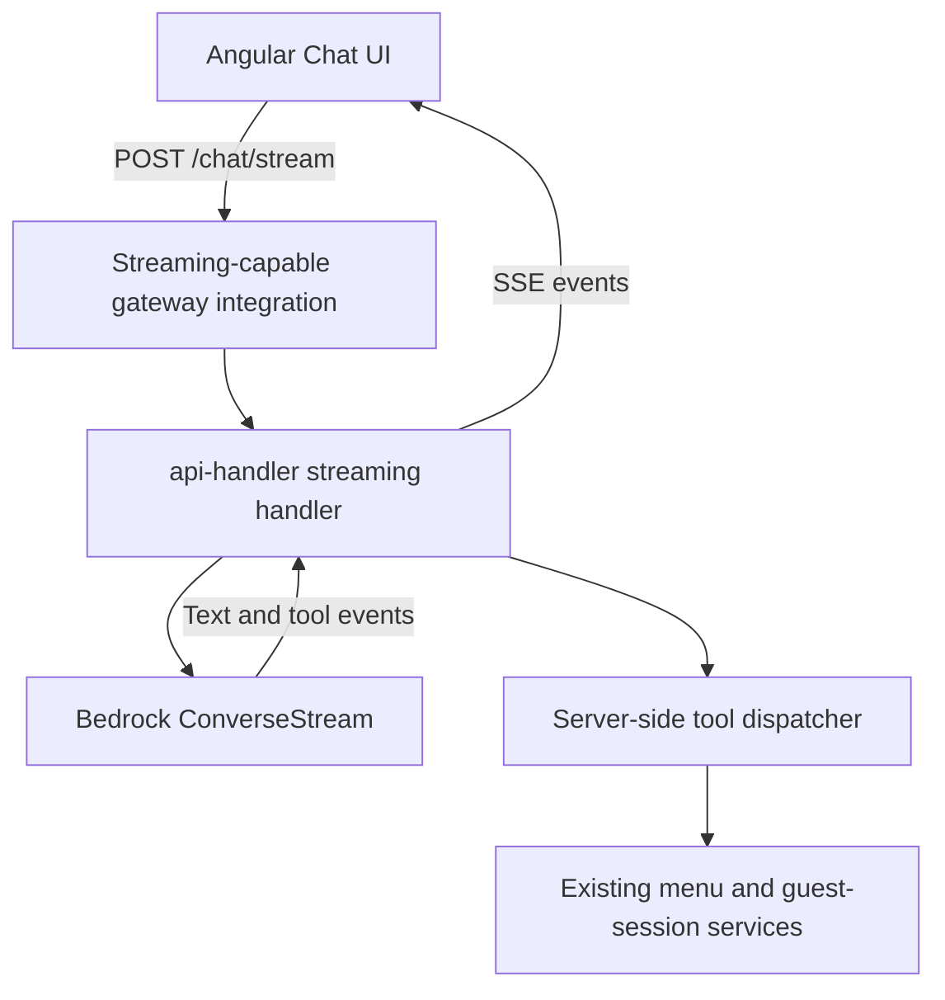

# AI Chat Streaming — Follow-up Stage

This document describes a possible streaming extension **after** the non-streaming POC in [AI_CHAT_ARCHITECTURE.md](./AI_CHAT_ARCHITECTURE.md) is deployed and verified. Streaming is not required for the initial POC.

## Feasibility gate

Before implementation, verify that the actual API Gateway type and Lambda integration in the deployed environment support response streaming end to end. The current backend route handlers return `APIGatewayProxyResponse`; that alone does not establish that the configured gateway can forward a Lambda response stream.

If the current integration does not support the required behavior, choose and document an appropriate supported architecture before writing the handler. Do not silently fall back to buffering a complete response while labeling it streaming.

## Proposed flow



## Stage scope

- Add a separate `POST /chat/stream` endpoint; keep `POST /chat` and its JSON contract working unchanged.
- Stream assistant text as it becomes available and represent tool execution explicitly.
- Execute tools only in the backend, using the same authorization and confirmation rules as the JSON endpoint.
- Preserve the same POC tool scope. Streaming does not grant the model additional abilities to modify carts or submit orders.
- Handle cancellation, client disconnects, upstream errors, and timeouts explicitly.
- Keep history bounded and avoid depending on Lambda process memory for cross-request state.

## Event contract to agree before implementation

Use `text/event-stream` only if the selected gateway integration can forward it as a true response stream. Define and test event names and payloads before wiring the frontend. A candidate contract is:

```text
event: message
data: {"text":"Вот меню"}

event: tool_status
data: {"name":"GetMenu","status":"started"}

event: tool_status
data: {"name":"GetMenu","status":"succeeded"}

event: done
data: {}
```

Errors must have an explicit event and documented behavior. Do not send internal exception details or credentials to the client.

## Frontend work

- Add a streaming-specific request path without changing the normal JSON method.
- Parse SSE framing across arbitrary network chunk boundaries; one `ReadableStream` chunk is not guaranteed to equal one SSE event.
- Handle non-success HTTP statuses, malformed events, stream termination, and cancellation.
- Keep the existing chat UI's loading and error states accurate throughout the stream.

## Verification

- Add backend tests for text events, tool event ordering, upstream errors, and cancellation where supported by the chosen integration.
- Add frontend tests for split/multiple SSE events per network chunk, terminal events, malformed payloads, and disconnects.
- Verify true incremental delivery through the deployed gateway; a unit test or direct Bedrock call does not prove end-to-end streaming.
